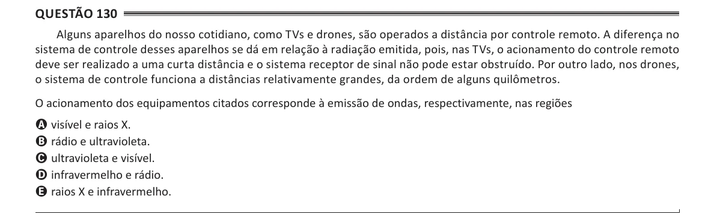

Texto extraído (pode conter ruído)

Questão 130  
Alguns aparelhos do nosso cotidiano, como TVs e drones, são operados a distância por controle remoto. A diferença no  
sistema de controle desses aparelhos se dá em relação à radiação emitida, pois, nas TVs, o acionamento do controle remoto  
deve ser realizado a uma curta distância e o sistema receptor de sinal não pode estar obstruído. Por outro lado, nos drones,  
o sistema de controle funciona a distâncias relativamente grandes, da ordem de alguns quilômetros.  
O acionamento dos equipamentos citados corresponde à emissão de ondas, respectivamente, nas regiões  
A visível e raios X.  
B rádio e ultravioleta.  
C ultravioleta e visível.  
D infravermelho e rádio.  
E raios X e infravermelho.

