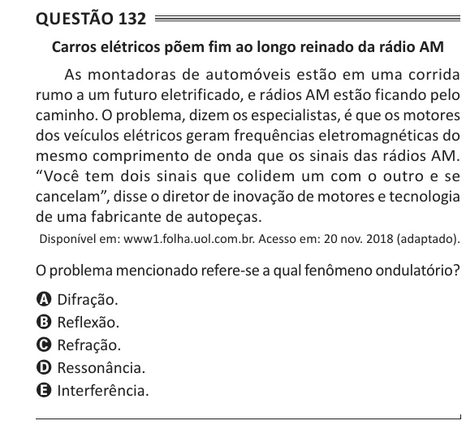

Texto extraído (pode conter ruído)

Questão 132  
Carros elétricos põem fim ao longo reinado da rádio AM  
As montadoras de automóveis estão em uma corrida  
rumo a um futuro eletrificado, e rádios AM estão ficando pelo  
caminho. O problema, dizem os especialistas, é que os motores  
dos veículos elétricos geram frequências eletromagnéticas do  
mesmo comprimento de onda que os sinais das rádios AM.  
“Você tem dois sinais que colidem um com o outro e se  
cancelam”, disse o diretor de inovação de motores e tecnologia  
de uma fabricante de autopeças.  
Disponível em: www1.folha.uol.com.br. Acesso em: 20 nov. 2018 (adaptado).  
O problema mencionado refere-se a qual fenômeno ondulatório?  
A Difração.  
B Reflexão.  
C Refração.  
D Ressonância.  
E Interferência.

