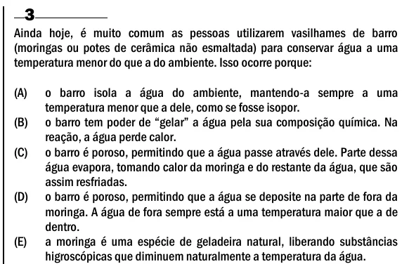

Texto extraído (pode conter ruído)

3  
Ainda hoje, é muito comum as pessoas utilizarem vasilhames de barro  
(moringas ou potes de cerâmica não esmaltada) para conservar água a uma  
temperatura menor do que a do ambiente. Isso ocorre porque:  
(A)  
o barro isola a água do ambiente, mantendo-a sempre a uma  
temperatura menor que a dele, como se fosse isopor.  
(B)  
o barro tem poder de “gelar” a água pela sua composição química. Na  
reação, a água perde calor.  
(C)  
o barro é poroso, permitindo que a água passe através dele. Parte dessa  
água evapora, tomando calor da moringa e do restante da água, que são  
assim resfriadas.  
(D)  
o barro é poroso, permitindo que a água se deposite na parte de fora da  
moringa. A água de fora sempre está a uma temperatura maior que a de  
dentro.  
(E)  
a moringa é uma espécie de geladeira natural, liberando substâncias  
higroscópicas que diminuem naturalmente a temperatura da água.

