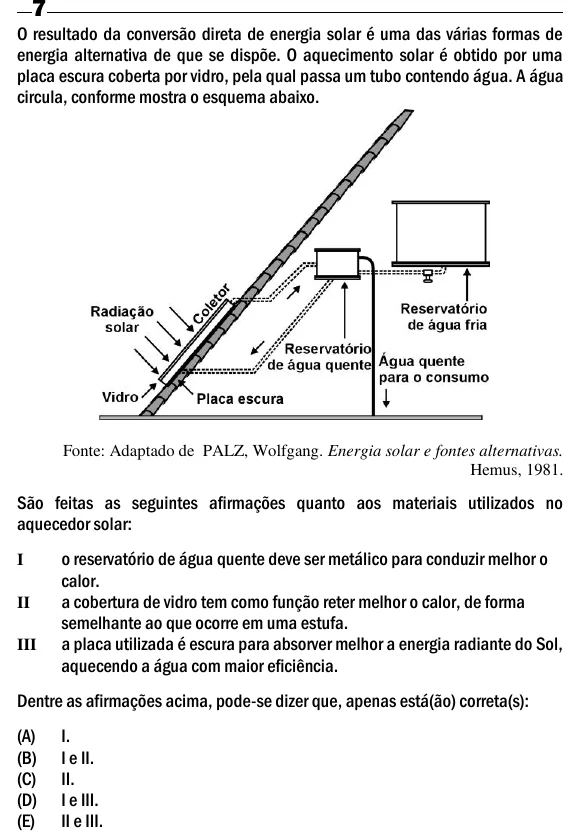

Texto extraído (pode conter ruído)

O resultado da conversão direta de energia solar é uma das várias formas de  
energia alternativa de que se dispõe. O aquecimento solar é obtido por uma  
placa escura coberta por vidro, pela qual passa um tubo contendo água. A água  
circula, conforme mostra o esquema abaixo.  
Fonte: Adaptado de PALZ, Wolfgang. Energia solar e fontes alternativas.  
Hemus, 1981.  
São feitas as seguintes afirmações quanto aos materiais utilizados no  
aquecedor solar:  
o reservatório de água quente deve ser metálico para conduzir melhor o  
I  
calor.  
a cobertura de vidro tem como função reter melhor o calor, de forma  
II  
semelhante ao que ocorre em uma estufa.  
a placa utilizada é escura para absorver melhor a energia radiante do Sol,  
III  
aquecendo a água com maior eficiência.  
Dentre as afirmações acima, pode-se dizer que, apenas está(ão) correta(s):  
(A)  
I.  
(B)  
I e II.  
(C)  
II.  
(D)  
I e III.  
(E)  
II e III.

