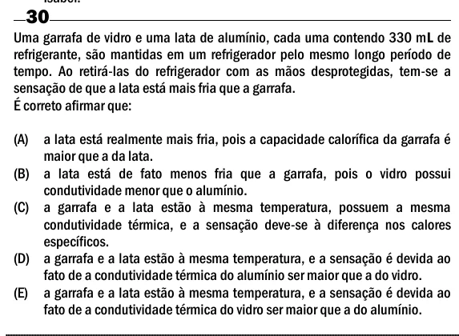

Texto extraído (pode conter ruído)

30  
Uma garrafa de vidro e uma lata de alumínio, cada uma contendo 330 mL de  
refrigerante, são mantidas em um refrigerador pelo mesmo longo período de  
tempo. Ao retirá-las do refrigerador com as mãos desprotegidas, tem-se a  
sensação de que a lata está mais fria que a garrafa.  
É correto afirmar que:  
(A) a lata está realmente mais fria, pois a capacidade calorífica da garrafa é  
maior que a da lata.  
(B) a lata está de fato menos fria que a garrafa, pois o vidro possui  
condutividade menor que o alumínio.  
(C) a garrafa e a lata estão à mesma temperatura, possuem a mesma  
condutividade térmica, e a sensação deve-se à diferença nos calores  
específicos.  
(D) a garrafa e a lata estão à mesma temperatura, e a sensação é devida ao  
fato de a condutividade térmica do alumínio ser maior que a do vidro.  
(E) a garrafa e a lata estão à mesma temperatura, e a sensação é devida ao  
fato de a condutividade térmica do vidro ser maior que a do alumínio.

