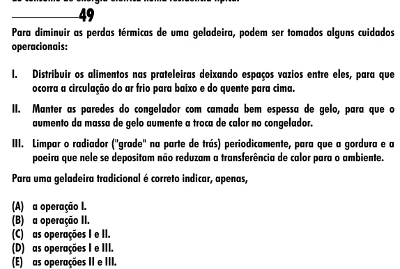

Texto extraído (pode conter ruído)

49  
Para diminuir as perdas térmicas de uma geladeira, podem ser tomados alguns cuidados  
operacionais:  
I.  
Distribuir os alimentos nas prateleiras deixando espaços vazios entre eles, para que  
ocorra a circulação do ar frio para baixo e do quente para cima.  
II.  
Manter as paredes do congelador com camada bem espessa de gelo, para que o  
aumento da massa de gelo aumente a troca de calor no congelador.  
III. Limpar o radiador ("grade" na parte de trás) periodicamente, para que a gordura e a  
poeira que nele se depositam não reduzam a transferência de calor para o ambiente.  
Para uma geladeira tradicional é correto indicar, apenas,  
(A) a operação I.  
(B) a operação II.  
(C) as operações I e II.  
(D) as operações I e III.  
(E) as operações II e III.

