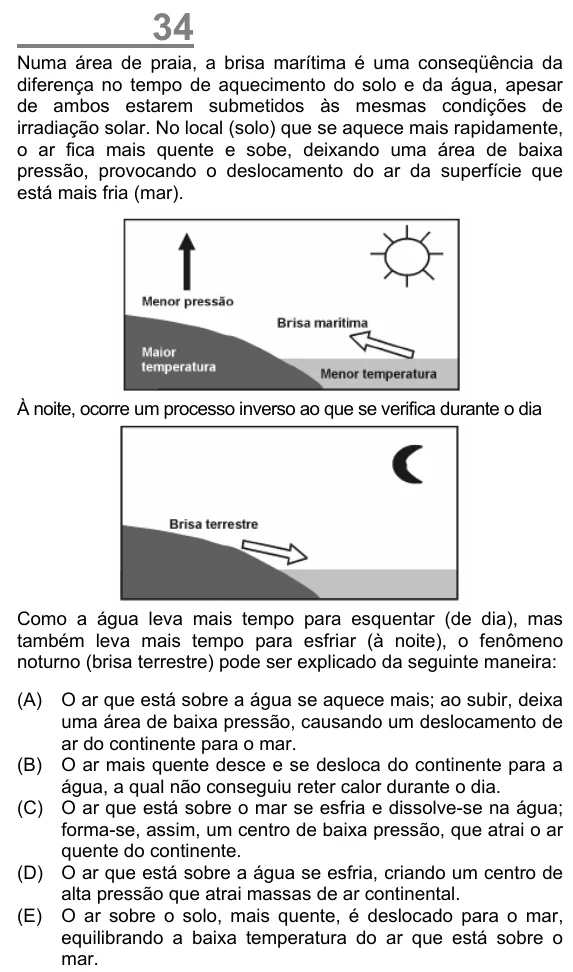

Texto extraído (pode conter ruído)

34  
Numa área de praia, a brisa marítima é uma conseqüência da  
diferença no tempo de aquecimento do solo e da água, apesar  
de ambos estarem submetidos às mesmas condições de  
irradiação solar. No local (solo) que se aquece mais rapidamente,  
o ar fica mais quente e sobe, deixando uma área de baixa  
pressão, provocando o deslocamento do ar da superfície que  
está mais fria (mar).  
À noite, ocorre um processo inverso ao que se verifica durante o dia  
Como a água leva mais tempo para esquentar (de dia), mas  
também leva mais tempo para esfriar (à noite), o fenômeno  
noturno (brisa terrestre) pode ser explicado da seguinte maneira:  
(A)  
O ar que está sobre a água se aquece mais; ao subir, deixa  
uma área de baixa pressão, causando um deslocamento de  
ar do continente para o mar.  
(B) O ar mais quente desce e se desloca do continente para a  
água, a qual não conseguiu reter calor durante o dia.  
(C) O ar que está sobre o mar se esfria e dissolve-se na água;  
forma-se, assim, um centro de baixa pressão, que atrai o ar  
quente do continente.  
(D) O ar que está sobre a água se esfria, criando um centro de  
alta pressão que atrai massas de ar continental.  
(E) O ar sobre o solo, mais quente, é deslocado para o mar,  
equilibrando a baixa temperatura do ar que está sobre o  
mar.

