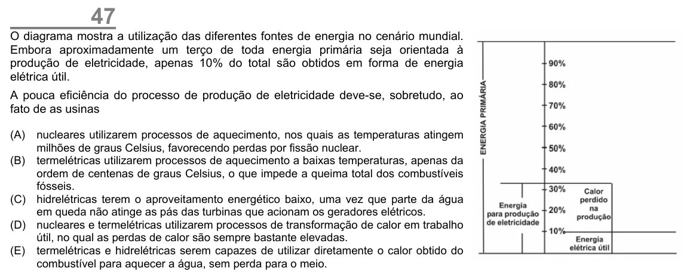

Texto extraído (pode conter ruído)

47  
O diagrama mostra a utilização das diferentes fontes de energia no cenário mundial.  
Embora aproximadamente um terço de toda energia primária seja orientada à  
produção de eletricidade, apenas 10% do total são obtidos em forma de energia  
elétrica útil.  
A pouca eficiência do processo de produção de eletricidade deve-se, sobretudo, ao  
fato de as usinas  
(A)  
nucleares utilizarem processos de aquecimento, nos quais as temperaturas atingem  
milhões de graus Celsius, favorecendo perdas por fissão nuclear.  
(B) termelétricas utilizarem processos de aquecimento a baixas temperaturas, apenas da  
ordem de centenas de graus Celsius, o que impede a queima total dos combustíveis  
fósseis.  
(C) hidrelétricas terem o aproveitamento energético baixo, uma vez que parte da água  
em queda não atinge as pás das turbinas que acionam os geradores elétricos.  
(D) nucleares e termelétricas utilizarem processos de transformação de calor em trabalho  
útil, no qual as perdas de calor são sempre bastante elevadas.  
(E) termelétricas e hidrelétricas serem capazes de utilizar diretamente o calor obtido do  
combustível para aquecer a água, sem perda para o meio.

