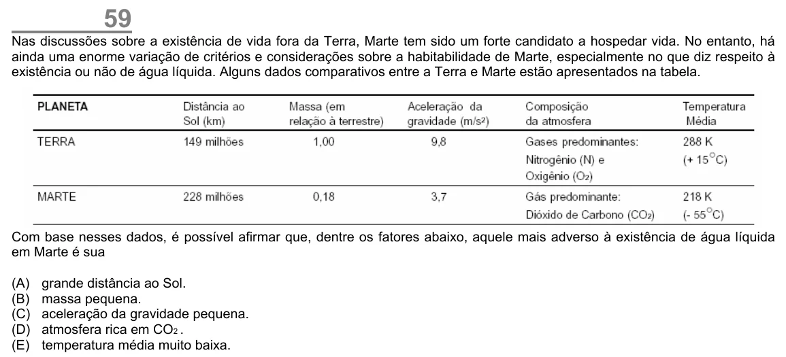

Texto extraído (pode conter ruído)

59  
Nas discussões sobre a existência de vida fora da Terra, Marte tem sido um forte candidato a hospedar vida. No entanto, há  
ainda uma enorme variação de critérios e considerações sobre a habitabilidade de Marte, especialmente no que diz respeito à  
existência ou não de água líquida. Alguns dados comparativos entre a Terra e Marte estão apresentados na tabela.  
Com base nesses dados, é possível afirmar que, dentre os fatores abaixo, aquele mais adverso à existência de água líquida  
em Marte é sua  
(A)  
grande distância ao Sol.  
(B)  
massa pequena.  
(C)  
aceleração da gravidade pequena.  
(D)  
atmosfera rica em CO 2 .  
(E)  
temperatura média muito baixa.

