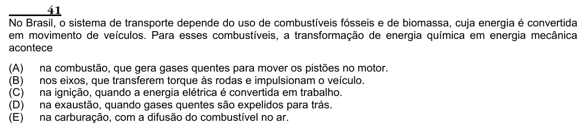

Texto extraído (pode conter ruído)

41  
No Brasil, o sistema de transporte depende do uso de combustíveis fósseis e de biomassa, cuja energia é convertida  
em movimento de veículos. Para esses combustíveis, a transformação de energia química em energia mecânica  
acontece  
(A)  
na combustão, que gera gases quentes para mover os pistões no motor.  
(B)  
nos eixos, que transferem torque às rodas e impulsionam o veículo.  
(C)  
na ignição, quando a energia elétrica é convertida em trabalho.  
(D)  
na exaustão, quando gases quentes são expelidos para trás.  
(E)  
na carburação, com a difusão do combustível no ar.

