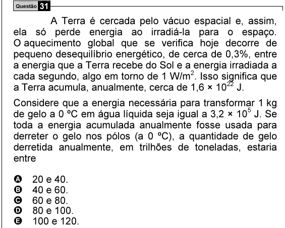

Texto extraído (pode conter ruído)

Questão 31  
A Terra é cercada pelo vácuo espacial e, assim,  
ela só perde energia ao irradiá-la para o espaço.  
O aquecimento global que se verifica hoje decorre de  
pequeno desequilíbrio energético, de cerca de 0,3%, entre  
a energia que a Terra recebe do Sol e a energia irradiada a  
cada segundo, algo em torno de 1 W/m 2 . Isso significa que  
a Terra acumula, anualmente, cerca de 1,6 × 10 22 J.  
Considere que a energia necessária para transformar 1 kg  
de gelo a 0 ºC em água líquida seja igual a 3,2 × 10 5 J. Se  
toda a energia acumulada anualmente fosse usada para  
derreter o gelo nos pólos (a 0 ºC), a quantidade de gelo  
derretida anualmente, em trilhões de toneladas, estaria  
entre  
A  
20 e 40.  
B  
40 e 60.  
C  
60 e 80.  
D  
80 e 100.  
E  
100 e 120.

