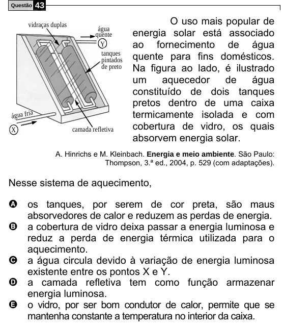

Texto extraído (pode conter ruído)

Questão  
43  
O uso mais popular de  
vidraças duplas  
água  
energia solar está associado  
quente  
ao fornecimento de água  
Y  
tanques  
quente para fins domésticos.  
pintados  
Na figura ao lado, é ilustrado  
de preto  
um  
aquecedor  
de  
água  
constituído de dois tanques  
pretos dentro de uma caixa  
termicamente isolada e com  
água fria  
cobertura de vidro, os quais  
X  
camada refletiva  
absorvem energia solar.  
A. Hinrichs e M. Kleinbach. Energia e meio ambiente. São Paulo:  
Thompson, 3.ª ed., 2004, p. 529 (com adaptações).  
Nesse sistema de aquecimento,  
A os tanques, por serem de cor preta, são maus  
absorvedores de calor e reduzem as perdas de energia.  
B a cobertura de vidro deixa passar a energia luminosa e  
reduz a perda de energia térmica utilizada para o  
aquecimento.  
C a água circula devido à variação de energia luminosa  
existente entre os pontos X e Y.  
D a camada refletiva tem como função armazenar  
energia luminosa.  
E o vidro, por ser bom condutor de calor, permite que se  
mantenha constante a temperatura no interior da caixa.

