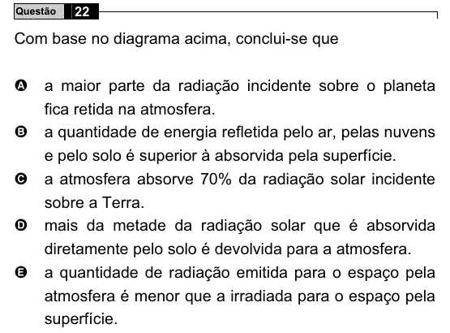

Texto extraído (pode conter ruído)

Questão  
22  
Com base no diagrama acima, conclui-se que  
A  
a maior parte da radiação incidente sobre o planeta  
fica retida na atmosfera.  
B  
a quantidade de energia refletida pelo ar, pelas nuvens  
e pelo solo é superior à absorvida pela superfície.  
C  
a atmosfera absorve 70% da radiação solar incidente  
sobre a Terra.  
mais da metade da radiação solar que é absorvida  
D  
diretamente pelo solo é devolvida para a atmosfera.  
a quantidade de radiação emitida para o espaço pela  
E  
atmosfera é menor que a irradiada para o espaço pela  
superfície.

