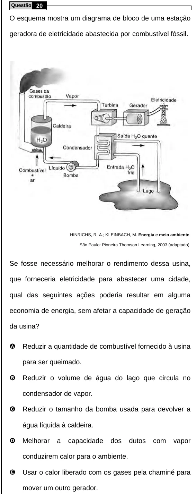

Texto extraído (pode conter ruído)

Questão 20  
O esquema mostra um diagrama de bloco de uma estação  
geradora de eletricidade abastecida por combustível fóssil.  
HINRICHS, R. A.; KLEINBACH, M. Energia e meio ambiente.  
São Paulo: Pioneira Thomson Learning, 2003 (adaptado).  
Se fosse necessário melhorar o rendimento dessa usina,  
que forneceria eletricidade para abastecer uma cidade,  
qual das seguintes ações poderia resultar em alguma  
economia de energia, sem afetar a capacidade de geração  
da usina?  
A  
Reduzir a quantidade de combustível fornecido à usina  
para ser queimado.  
B  
Reduzir o volume de água do lago que circula no  
condensador de vapor.  
C  
Reduzir o tamanho da bomba usada para devolver a  
água líquida à caldeira.  
D  
Melhorar  
a  
capacidade  
dos  
dutos  
com  
vapor  
conduzirem calor para o ambiente.  
E  
Usar o calor liberado com os gases pela chaminé para  
mover um outro gerador.

