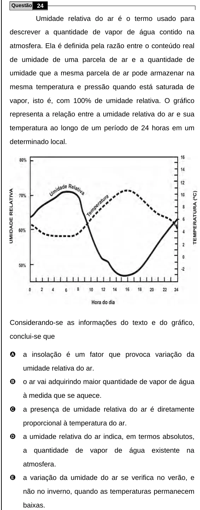

Texto extraído (pode conter ruído)

Questão 24  
Umidade relativa do ar é o termo usado para  
descrever a quantidade de vapor de água contido na  
atmosfera. Ela é definida pela razão entre o conteúdo real  
de umidade de uma parcela de ar e a quantidade de  
umidade que a mesma parcela de ar pode armazenar na  
mesma temperatura e pressão quando está saturada de  
vapor, isto é, com 100% de umidade relativa. O gráfico  
representa a relação entre a umidade relativa do ar e sua  
temperatura ao longo de um período de 24 horas em um  
determinado local.  
Considerando-se as informações do texto e do gráfico,  
conclui-se que  
A  
a insolação é um fator que provoca variação da  
umidade relativa do ar.  
B  
o ar vai adquirindo maior quantidade de vapor de água  
à medida que se aquece.  
C  
a presença de umidade relativa do ar é diretamente  
proporcional à temperatura do ar.  
D  
a umidade relativa do ar indica, em termos absolutos,  
a quantidade de vapor de água existente na  
atmosfera.  
E  
a variação da umidade do ar se verifica no verão, e  
não no inverno, quando as temperaturas permanecem  
baixas.

