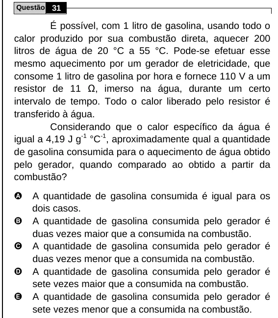

Texto extraído (pode conter ruído)

Questão 31  
É possível, com 1 litro de gasolina, usando todo o  
calor produzido por sua combustão direta, aquecer 200  
litros de água de 20 °C a 55 °C. Pode-se efetuar esse  
mesmo aquecimento por um gerador de eletricidade, que  
consome 1 litro de gasolina por hora e fornece 110 V a um  
resistor de 11 Ω, imerso na água, durante um certo  
intervalo de tempo. Todo o calor liberado pelo resistor é  
transferido à água.  
Considerando que o calor específico da água é  
igual a 4,19 J g -1 °C -1 , aproximadamente qual a quantidade  
de gasolina consumida para o aquecimento de água obtido  
pelo gerador, quando comparado ao obtido a partir da  
combustão?  
A  
A quantidade de gasolina consumida é igual para os  
dois casos.  
B  
A quantidade de gasolina consumida pelo gerador é  
duas vezes maior que a consumida na combustão.  
C  
A quantidade de gasolina consumida pelo gerador é  
duas vezes menor que a consumida na combustão.  
D  
A quantidade de gasolina consumida pelo gerador é  
sete vezes maior que a consumida na combustão.  
E  
A quantidade de gasolina consumida pelo gerador é  
sete vezes menor que a consumida na combustão.

