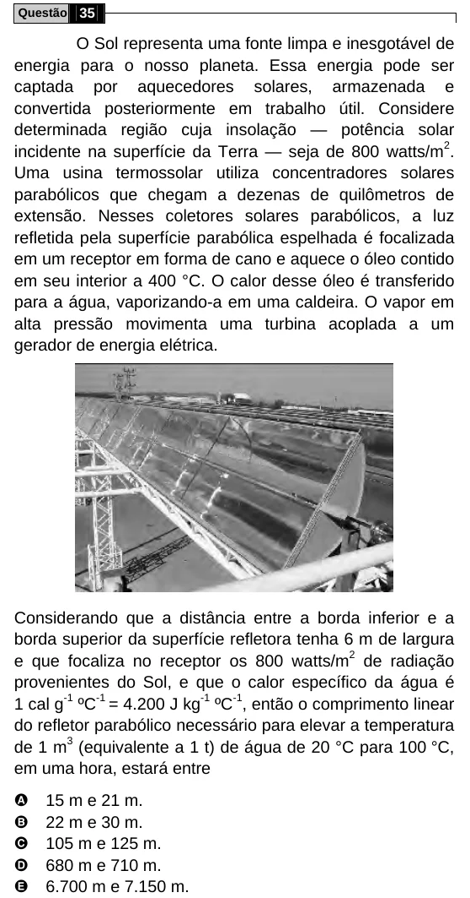

Texto extraído (pode conter ruído)

Questão 35  
O Sol representa uma fonte limpa e inesgotável de  
energia para o nosso planeta. Essa energia pode ser  
captada por aquecedores solares, armazenada e  
convertida posteriormente em trabalho útil. Considere  
determinada região cuja insolação — potência solar  
incidente na superfície da Terra — seja de 800 watts/m 2 .  
Uma usina termossolar utiliza concentradores solares  
parabólicos que chegam a dezenas de quilômetros de  
extensão. Nesses coletores solares parabólicos, a luz  
refletida pela superfície parabólica espelhada é focalizada  
em um receptor em forma de cano e aquece o óleo contido  
em seu interior a 400 °C. O calor desse óleo é transferido  
para a água, vaporizando-a em uma caldeira. O vapor em  
alta pressão movimenta uma turbina acoplada a um  
gerador de energia elétrica.  
Considerando que a distância entre a borda inferior e a  
borda superior da superfície refletora tenha 6 m de largura  
e que focaliza no receptor os 800 watts/m 2 de radiação  
provenientes do Sol, e que o calor específico da água é  
1 cal g -1 ºC -1 = 4.200 J kg -1 ºC -1 , então o comprimento linear  
do refletor parabólico necessário para elevar a temperatura  
de 1 m 3 (equivalente a 1 t) de água de 20 °C para 100 °C,  
em uma hora, estará entre  
A  
15 m e 21 m.  
B  
22 m e 30 m.  
C  
105 m e 125 m.  
D  
680 m e 710 m.  
E  
6.700 m e 7.150 m.

