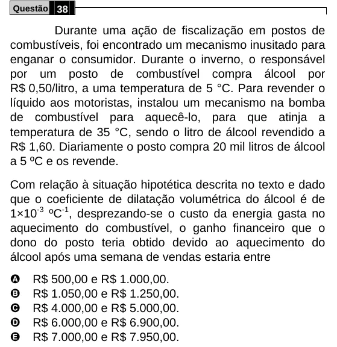

Texto extraído (pode conter ruído)

Questão 38  
Durante uma ação de fiscalização em postos de  
combustíveis, foi encontrado um mecanismo inusitado para  
enganar o consumidor. Durante o inverno, o responsável  
por um posto de combustível compra álcool por  
R$ 0,50/litro, a uma temperatura de 5 °C. Para revender o  
líquido aos motoristas, instalou um mecanismo na bomba  
de combustível para aquecê-lo, para que atinja a  
temperatura de 35 °C, sendo o litro de álcool revendido a  
R$ 1,60. Diariamente o posto compra 20 mil litros de álcool  
a 5 ºC e os revende.  
Com relação à situação hipotética descrita no texto e dado  
que o coeficiente de dilatação volumétrica do álcool é de  
1×10 -3 ºC -1 , desprezando-se o custo da energia gasta no  
aquecimento do combustível, o ganho financeiro que o  
dono do posto teria obtido devido ao aquecimento do  
álcool após uma semana de vendas estaria entre  
A  
R$ 500,00 e R$ 1.000,00.  
B  
R$ 1.050,00 e R$ 1.250,00.  
C  
R$ 4.000,00 e R$ 5.000,00.  
D  
R$ 6.000,00 e R$ 6.900,00.  
E  
R$ 7.000,00 e R$ 7.950,00.

