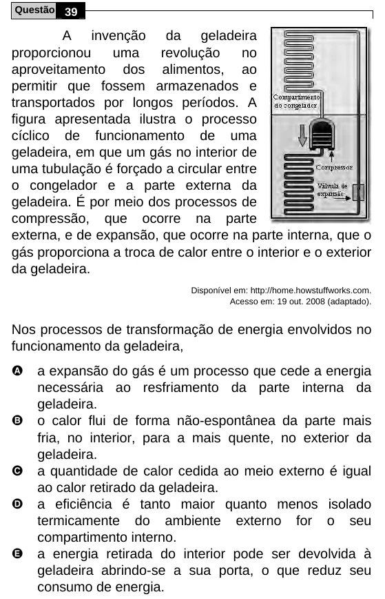

Texto extraído (pode conter ruído)

Questão 39  
A invenção da geladeira  
proporcionou  
uma  
revolução  
no  
aproveitamento dos alimentos, ao  
permitir que fossem armazenados e  
transportados por longos períodos. A  
figura apresentada ilustra o processo  
cíclico de funcionamento de uma  
geladeira, em que um gás no interior de  
uma tubulação é forçado a circular entre  
o congelador e a parte externa da  
geladeira. É por meio dos processos de  
compressão, que ocorre na parte  
externa, e de expansão, que ocorre na parte interna, que o  
gás proporciona a troca de calor entre o interior e o exterior  
da geladeira.  
Disponível em: http://home.howstuffworks.com.  
Acesso em: 19 out. 2008 (adaptado).  
Nos processos de transformação de energia envolvidos no  
funcionamento da geladeira,  
A  
a expansão do gás é um processo que cede a energia  
necessária ao resfriamento da parte interna da  
geladeira.  
B  
o calor flui de forma não-espontânea da parte mais  
fria, no interior, para a mais quente, no exterior da  
geladeira.  
C  
a quantidade de calor cedida ao meio externo é igual  
ao calor retirado da geladeira.  
D  
a eficiência é tanto maior quanto menos isolado  
termicamente do ambiente externo for o seu  
compartimento interno.  
E  
a energia retirada do interior pode ser devolvida à  
geladeira abrindo-se a sua porta, o que reduz seu  
consumo de energia.

