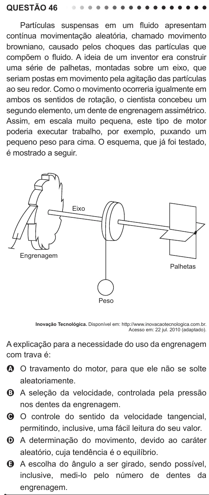

Texto extraído (pode conter ruído)

QUESTÃO 46  
Partículas suspensas em um fluido apresentam  
contínua movimentação aleatória, chamado movimento  
browniano, causado pelos choques das partículas que  
compõem o fluido. A ideia de um inventor era construir  
uma série de palhetas, montadas sobre um eixo, que  
seriam postas em movimento pela agitação das partículas  
ao seu redor. Como o movimento ocorreria igualmente em  
ambos os sentidos de rotação, o cientista concebeu um  
segundo elemento, um dente de engrenagem assimétrico.  
Assim, em escala muito pequena, este tipo de motor  
poderia executar trabalho, por exemplo, puxando um  
pequeno peso para cima. O esquema, que já foi testado,  
é mostrado a seguir.  
Eixo  
Engrenagem  
Palhetas  
Peso  
Inovação Tecnológica. Disponível em: http://www.inovacaotecnologica.com.br.  
Acesso em: 22 jul. 2010 (adaptado).  
A explicação para a necessidade do uso da engrenagem  
com trava é:  
A O travamento do motor, para que ele não se solte  
aleatoriamente.  
B A seleção da velocidade, controlada pela pressão  
nos dentes da engrenagem.  
C O controle do sentido da velocidade tangencial,  
permitindo, inclusive, uma fácil leitura do seu valor.  
D A determinação do movimento, devido ao caráter  
aleatório, cuja tendência é o equilíbrio.  
E A escolha do ângulo a ser girado, sendo possível,  
inclusive, medi-lo pelo número de dentes da  
engrenagem.

