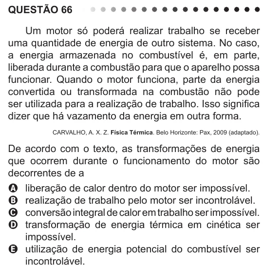

Texto extraído (pode conter ruído)

QUESTÃO 66  
Um motor só poderá realizar trabalho se receber  
uma quantidade de energia de outro sistema. No caso,  
a energia armazenada no combustível é, em parte,  
liberada durante a combustão para que o aparelho possa  
funcionar. Quando o motor funciona, parte da energia  
convertida ou transformada na combustão não pode  
ser utilizada para a realização de trabalho. Isso significa  
dizer que há vazamento da energia em outra forma.  
CARVALHO, A. X. Z. Física Térmica. Belo Horizonte: Pax, 2009 (adaptado).  
De acordo com o texto, as transformações de energia  
que ocorrem durante o funcionamento do motor são  
decorrentes de a  
A liberação de calor dentro do motor ser impossível.  
B realização de trabalho pelo motor ser incontrolável.  
C conversão integral de calor em trabalho ser impossível.  
D transformação de energia térmica em cinética ser  
impossível.  
E utilização de energia potencial do combustível ser  
incontrolável.

