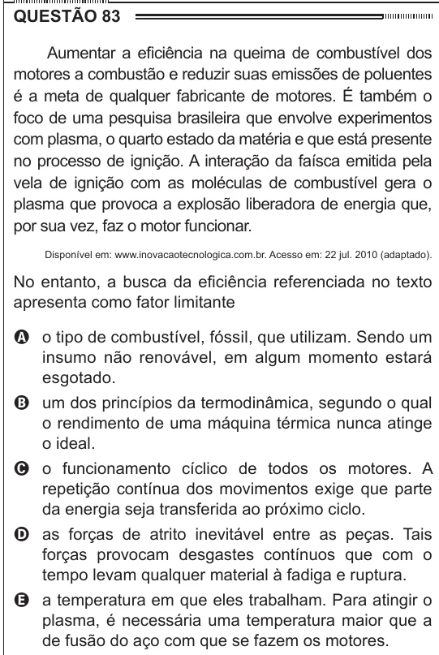

Texto extraído (pode conter ruído)

QUESTÃO 83  
Aumentar a eficiência na queima de combustível dos  
motores a combustão e reduzir suas emissões de poluentes  
é a meta de qualquer fabricante de motores. É também o  
foco de uma pesquisa brasileira que envolve experimentos  
com plasma, o quarto estado da matéria e que está presente  
no processo de ignição. A interação da faísca emitida pela  
vela de ignição com as moléculas de combustível gera o  
plasma que provoca a explosão liberadora de energia que,  
por sua vez, faz o motor funcionar.  
Disponível em: www.inovacaotecnologica.com.br. Acesso em: 22 jul. 2010 (adaptado).  
No entanto, a busca da eficiência referenciada no texto  
apresenta como fator limitante  
A o tipo de combustível, fóssil, que utilizam. Sendo um  
insumo não renovável, em algum momento estará  
esgotado.  
B um dos princípios da termodinâmica, segundo o qual  
o rendimento de uma máquina térmica nunca atinge  
o ideal.  
C o funcionamento cíclico de todos os motores. A  
repetição contínua dos movimentos exige que parte  
da energia seja transferida ao próximo ciclo.  
D as forças de atrito inevitável entre as peças. Tais  
forças provocam desgastes contínuos que com o  
tempo levam qualquer material à fadiga e ruptura.  
E a temperatura em que eles trabalham. Para atingir o  
plasma, é necessária uma temperatura maior que a  
de fusão do aço com que se fazem os motores.

