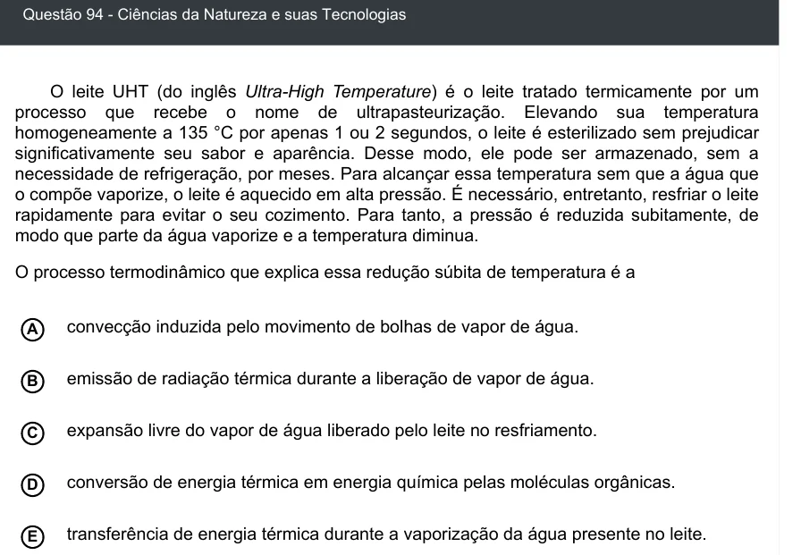

Texto extraído (pode conter ruído)

Questão 94 - Ciências da Natureza e suas Tecnologias  
O leite UHT (do inglês Ultra-High Temperature) é o leite tratado termicamente por um  
processo que recebe o nome de ultrapasteurização. Elevando sua temperatura  
homogeneamente a 135 °C por apenas 1 ou 2 segundos, o leite é esterilizado sem prejudicar  
significativamente seu sabor e aparência. Desse modo, ele pode ser armazenado, sem a  
necessidade de refrigeração, por meses. Para alcançar essa temperatura sem que a água que  
o compõe vaporize, o leite é aquecido em alta pressão. É necessário, entretanto, resfriar o leite  
rapidamente para evitar o seu cozimento. Para tanto, a pressão é reduzida subitamente, de  
modo que parte da água vaporize e a temperatura diminua.  
O processo termodinâmico que explica essa redução súbita de temperatura é a  
convecção induzida pelo movimento de bolhas de vapor de água.  
A  
emissão de radiação térmica durante a liberação de vapor de água.  
B  
expansão livre do vapor de água liberado pelo leite no resfriamento.  
C  
D  
conversão de energia térmica em energia química pelas moléculas orgânicas.  
transferência de energia térmica durante a vaporização da água presente no leite.  
E

