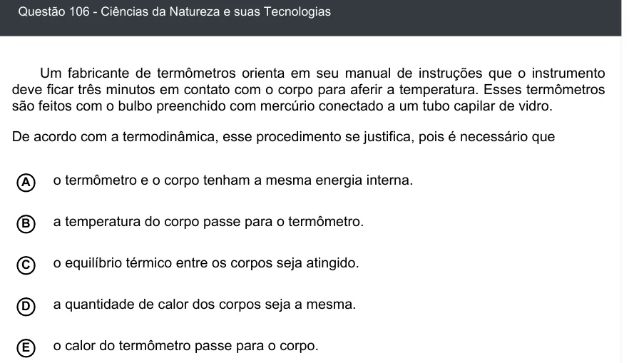

Texto extraído (pode conter ruído)

Questão 106 - Ciências da Natureza e suas Tecnologias  
Um fabricante de termômetros orienta em seu manual de instruções que o instrumento  
deve ficar três minutos em contato com o corpo para aferir a temperatura. Esses termômetros  
são feitos com o bulbo preenchido com mercúrio conectado a um tubo capilar de vidro.  
De acordo com a termodinâmica, esse procedimento se justifica, pois é necessário que  
A  
o termômetro e o corpo tenham a mesma energia interna.  
a temperatura do corpo passe para o termômetro.  
B  
o equilíbrio térmico entre os corpos seja atingido.  
C  
D  
a quantidade de calor dos corpos seja a mesma.  
o calor do termômetro passe para o corpo.  
E

