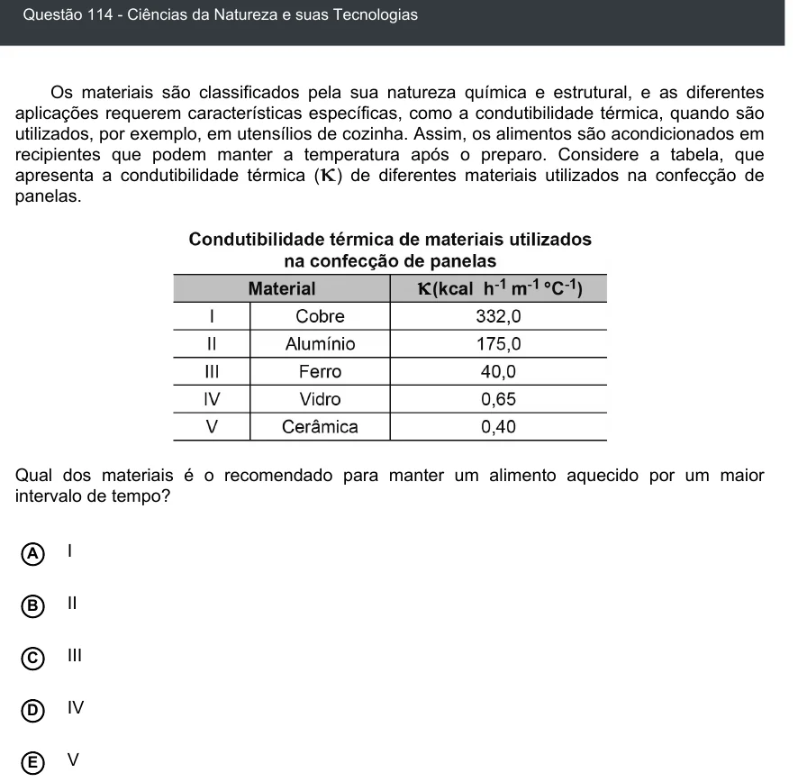

Texto extraído (pode conter ruído)

Questão 114 - Ciências da Natureza e suas Tecnologias  
Os materiais são classificados pela sua natureza química e estrutural, e as diferentes  
aplicações requerem características específicas, como a condutibilidade térmica, quando são  
utilizados, por exemplo, em utensílios de cozinha. Assim, os alimentos são acondicionados em  
recipientes que podem manter a temperatura após o preparo. Considere a tabela, que  
apresenta a condutibilidade térmica ( ) de diferentes materiais utilizados na confecção de  
panelas.  
Qual dos materiais é o recomendado para manter um alimento aquecido por um maior  
intervalo de tempo?  
I  
A  
B  
II  
C  
III  
IV  
D  
V  
E

