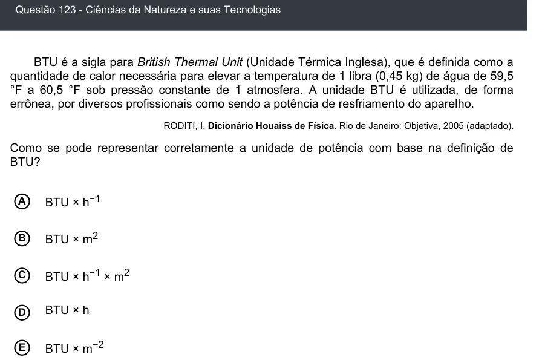

Texto extraído (pode conter ruído)

Questão 123 - Ciências da Natureza e suas Tecnologias  
BTU é a sigla para British Thermal Unit (Unidade Térmica Inglesa), que é definida como a  
quantidade de calor necessária para elevar a temperatura de 1 libra (0,45 kg) de água de 59,5  
°F a 60,5 °F sob pressão constante de 1 atmosfera. A unidade BTU é utilizada, de forma  
errônea, por diversos profissionais como sendo a potência de resfriamento do aparelho.  
RODITI, I. Dicionário Houaiss de Física. Rio de Janeiro: Objetiva, 2005 (adaptado).  
Como se pode representar corretamente a unidade de potência com base na definição de  
BTU?  
BTU × h −1  
A  
BTU × m 2  
B  
C  
BTU × h −1 × m 2  
BTU × h  
D  
E  
BTU × m −2

