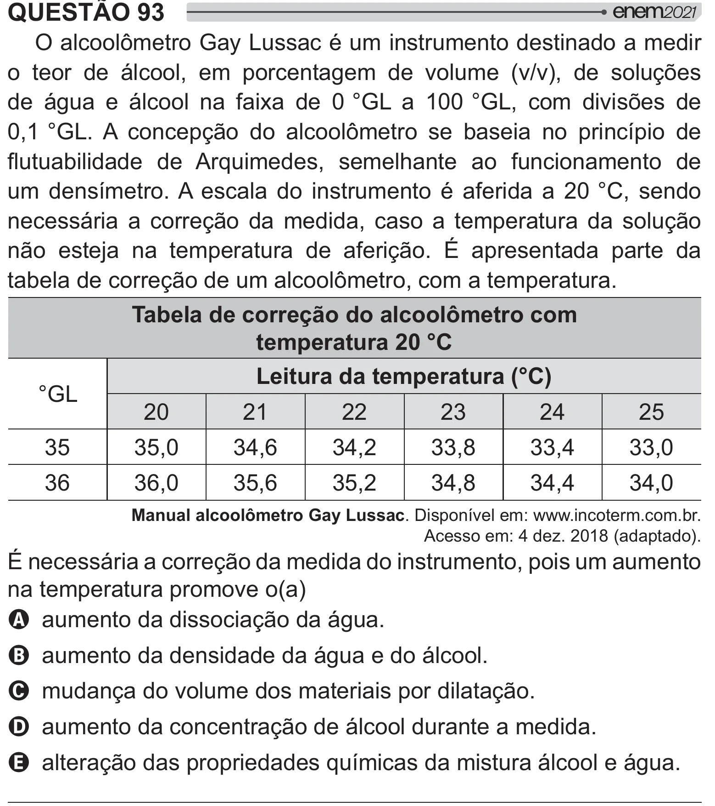

Texto extraído (pode conter ruído)

QUESTÃO 93  
2 ^@?  
<         
o teor de álcool, em porcentagem de volume (v/v), de soluções  
de água e álcool na faixa de 0 °GL a 100 °GL, com divisões de  
_`w^?!   #=[  2   y   #{#    
} y         $   >       
um densímetro. A escala do instrumento é aferida a 20 °C, sendo  
necessária a correção da medida, caso a temperatura da solução  
não esteja na temperatura de aferição. É apresentada parte da  
y   =[  2  #  !  
Tabela de correção do alcoolômetro com  
temperatura 20 °C  
Leitura da temperatura (°C)  
°GL  
20  
21  
22  
23  
24  
25  
35  
35,0  
34,6  
34,2  
33,8  
33,4  
33,0  
36  
36,0  
35,6  
35,2  
34,8  
34,4  
34,0  
Manual alcoolômetro Gay Lussac. Disponível em: www.incoterm.com.br.  
Acesso em: 4 dez. 2018 (adaptado).  
É necessária a correção da medida do instrumento, pois um aumento  
na temperatura promove o(a)  
A aumento da dissociação da água.  
B aumento da densidade da água e do álcool.  
C mudança do volume dos materiais por dilatação.  
D aumento da concentração de álcool durante a medida.  
E alteração das propriedades químicas da mistura álcool e água.

