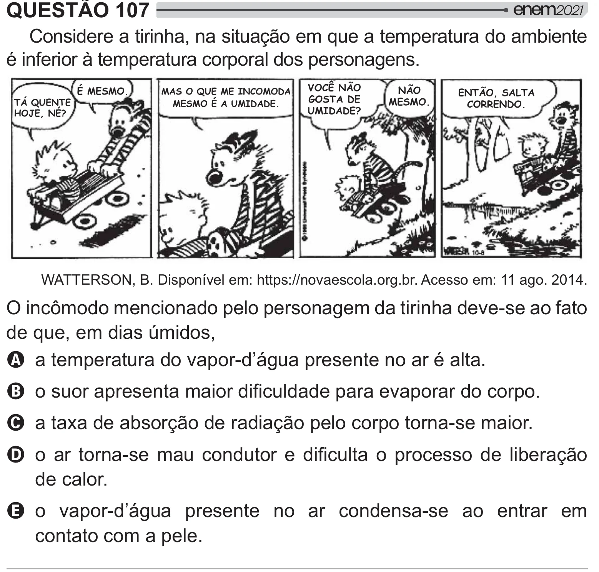

Texto extraído (pode conter ruído)

QUESTÃO 107  
Considere a tirinha, na situação em que a temperatura do ambiente  
é inferior à temperatura corporal dos personagens.  
VOCÊ NÃO  
É MESMO.  
NÃO  
MAS O QUE ME INCOMODA  
ENTÃO, SALTA  
GOSTA DE  
TÁ QUENTE  
MESMO.  
MESMO É A UMIDADE.  
CORRENDO.  
UMIDADE?  
HOJE, NÉ?  
Xˆš!% #{"  œ$ # œBB"  
!!y!  
 œ``!‘_`!  
2 # #    $ "   
>   
de que, em dias úmidos,  
A a temperatura do vapor-d’água presente no ar é alta.  
B   
#  
   # "##!  
C a taxa de absorção de radiação pelo corpo torna-se maior.  
D     
          #  
   y =[  
de calor.  
E o vapor-d’água presente no ar condensa-se ao entrar em  
contato com a pele.

