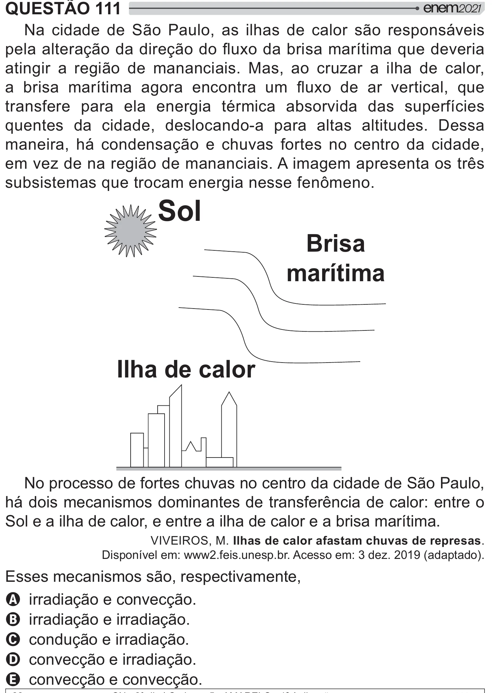

Texto extraído (pode conter ruído)

QUESTÃO 111  
Na cidade de São Paulo, as ilhas de calor são responsáveis  
#  =[ =[} *y {   
 "   
atingir a região de mananciais. Mas, ao cruzar a ilha de calor,  
 y  {      } *    "    
  
transfere para ela energia térmica absorvida das superfícies  
quentes da cidade, deslocando-a para altas altitudes. Dessa  
maneira, há condensação e chuvas fortes no centro da cidade,  
em vez de na região de mananciais. A imagem apresenta os três  
y     
     
> 2 !  
Sol  
Brisa  
marítima  
Ilha de calor  
No processo de fortes chuvas no centro da cidade de São Paulo,  
há dois mecanismos dominantes de transferência de calor: entre o  
Sol e a ilha de calor, e entre a ilha de calor e a brisa marítima.  
VIVEIROS, M. Ilhas de calor afastam chuvas de represas.  
Disponível em: www2.feis.unesp.br. Acesso em: 3 dez. 2019 (adaptado).  
Esses mecanismos são, respectivamente,  
A irradiação e convecção.  
B irradiação e irradiação.  
C condução e irradiação.  
D convecção e irradiação.  
E convecção e convecção.

