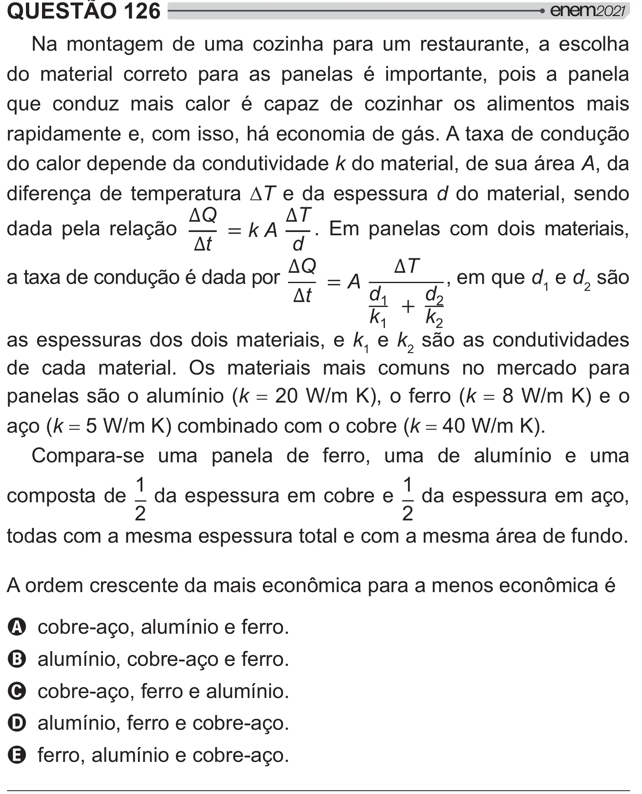

Texto extraído (pode conter ruído)

QUESTÃO 126  
Na montagem de uma cozinha para um restaurante, a escolha  
do material correto para as panelas é importante, pois a panela  
que conduz mais calor é capaz de cozinhar os alimentos mais  
rapidamente e, com isso, há economia de gás. A taxa de condução  
do calor depende da condutividade k do material, de sua área A, da  
diferença de temperatura 'T e da espessura d do material, sendo  
Q  
T  
 kA  
dada pela relação  
. Em panelas com dois materiais,  
t  
d  
Q  
T  
a taxa de condução é dada por  
 A  
, em que d 1 e d 2 são  
t  
d `  
d  
 ‘  
k `  
k ‘  
as espessuras dos dois materiais, e k 1 e k 2 são as condutividades  
de cada material. Os materiais mais comuns no mercado para  
panelas são o alumínio (k ‘_XB±W> Jk £XB±W   
aço (k XB±Wyy Jk _XB±W!  
Compara-se uma panela de ferro, uma de alumínio e uma  
`  
`  
composta de da espessura em cobre e da espessura em aço,  
‘  
‘  
todas com a mesma espessura total e com a mesma área de fundo.  
   
    2#   2<  
A cobre-aço, alumínio e ferro.  
B alumínio, cobre-aço e ferro.  
C cobre-aço, ferro e alumínio.  
D alumínio, ferro e cobre-aço.  
E ferro, alumínio e cobre-aço.

