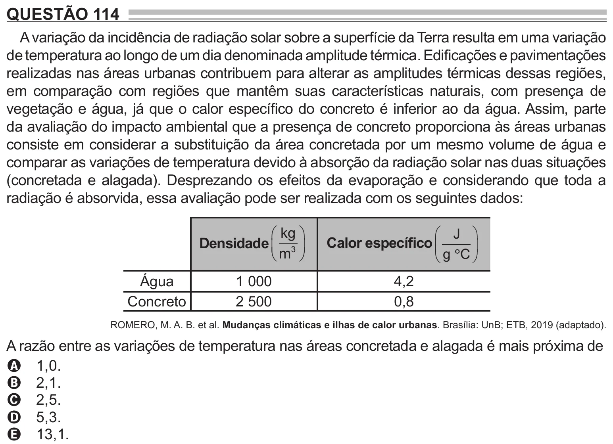

Texto extraído (pode conter ruído)

QUESTÃO 114  
A variação da incidência de radiação solar sobre a superfície da Terra resulta em uma variação  
de temperatura ao longo de um dia denominada amplitude térmica. Edificações e pavimentações  
realizadas nas áreas urbanas contribuem para alterar as amplitudes térmicas dessas regiões,  
em comparação com regiões que mantêm suas características naturais, com presença de  
vegetação e água, já que o calor específico do concreto é inferior ao da água. Assim, parte  
da avaliação do impacto ambiental que a presença de concreto proporciona às áreas urbanas  
consiste em considerar a substituição da área concretada por um mesmo volume de água e  
comparar as variações de temperatura devido à absorção da radiação solar nas duas situações  
(concretada e alagada). Desprezando os efeitos da evaporação e considerando que toda a  
radiação é absorvida, essa avaliação pode ser realizada com os seguintes dados:  
 kg   
 J   
Densidade  3   
Calor específi co   
  
 m   
 g  C   
Água  
1 000  
4,2  
Concreto  
2 500  
0,8  
ROMERO, M. A. B. et al. Mudanças climáticas e ilhas de calor urbanas. Brasília: UnB; ETB, 2019 (adaptado).  
A razão entre as variações de temperatura nas áreas concretada e alagada é mais próxima de  
A 1,0.  
B 2,1.  
C 2,5.  
D 5,3.  
E 13,1.

