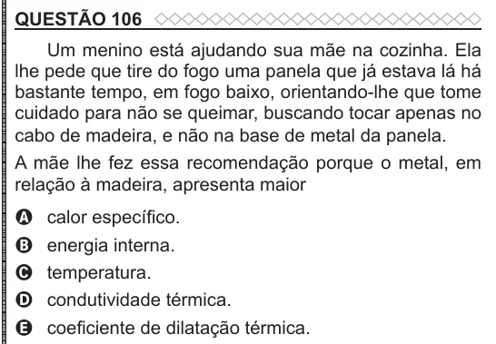

Texto extraído (pode conter ruído)

QUESTÃO 106  
Um menino está ajudando sua mãe na cozinha. Ela  
lhe pede que tire do fogo uma panela que já estava lá há  
bastante tempo, em fogo baixo, orientando-lhe que tome  
cuidado para não se queimar, buscando tocar apenas no  
cabo de madeira, e não na base de metal da panela.  
A mãe lhe fez essa recomendação porque o metal, em  
relação à madeira, apresenta maior  
A  
calor específico.  
B  
energia interna.  
temperatura.  
C  
condutividade térmica.  
D  
coeficiente de dilatação térmica.  
E

