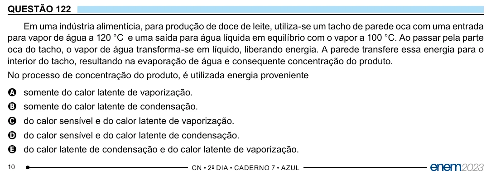

Texto extraído (pode conter ruído)

QUESTÃO 122  
Em uma indústria alimentícia, para produção de doce de leite, utiliza-se um tacho de parede oca com uma entrada  
para vapor de água a 120 °C e uma saída para água líquida em equilíbrio com o vapor a 100 °C. Ao passar pela parte  
oca do tacho, o vapor de água transforma-se em líquido, liberando energia. A parede transfere essa energia para o  
interior do tacho, resultando na evaporação de água e consequente concentração do produto.  
No processo de concentração do produto, é utilizada energia proveniente  
A somente do calor latente de vaporização.  
B somente do calor latente de condensação.  
C do calor sensível e do calor latente de vaporização.  
D do calor sensível e do calor latente de condensação.  
E do calor latente de condensação e do calor latente de vaporização.  
10

