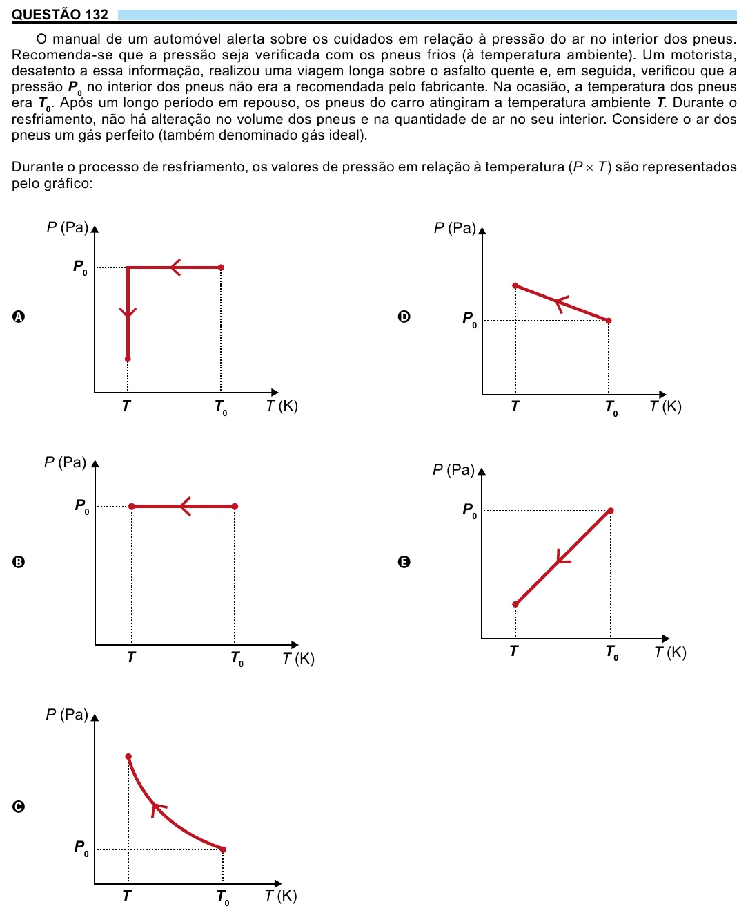

Texto extraído (pode conter ruído)

QUESTÃO 132  
O manual de um automóvel alerta sobre os cuidados em relação à pressão do ar no interior dos pneus.  
Recomenda-se que a pressão seja verificada com os pneus frios (à temperatura ambiente). Um motorista,  
desatento a essa informação, realizou uma viagem longa sobre o asfalto quente e, em seguida, verificou que a  
pressão P 0 no interior dos pneus não era a recomendada pelo fabricante. Na ocasião, a temperatura dos pneus  
era T 0 . Após um longo período em repouso, os pneus do carro atingiram a temperatura ambiente T. Durante o  
resfriamento, não há alteração no volume dos pneus e na quantidade de ar no seu interior. Considere o ar dos  
pneus um gás perfeito (também denominado gás ideal).  
Durante o processo de resfriamento, os valores de pressão em relação à temperatura (P × T) são representados  
pelo gráfico:  
P (Pa)  
P (Pa)  
P 0  
A  
D  
P 0  
T  
T 0  
T (K)  
T  
T 0  
T (K)  
P (Pa)  
P (Pa)  
P 0  
P 0  
B  
E  
T  
T 0  
T (K)  
T  
T 0  
T (K)  
P (Pa)  
C  
P 0  
T (K)  
T  
T 0  
14

