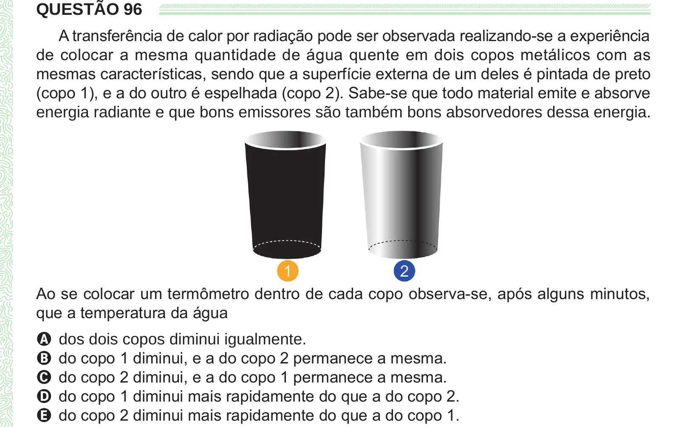

Texto extraído (pode conter ruído)

QUESTÃO 96  
A transferência de calor por radiação pode ser observada realizando-se a experiência  
de colocar a mesma quantidade de água quente em dois copos metálicos com as  
mesmas características, sendo que a superfície externa de um deles é pintada de preto  
(copo 1), e a do outro é espelhada (copo 2). Sabe-se que todo material emite e absorve  
energia radiante e que bons emissores são também bons absorvedores dessa energia.  
Ao se colocar um termômetro dentro de cada copo observa-se, após alguns minutos,  
que a temperatura da água  
A dos dois copos diminui igualmente.  
B do copo 1 diminui, e a do copo 2 permanece a mesma.  
C do copo 2 diminui, e a do copo 1 permanece a mesma.  
D do copo 1 diminui mais rapidamente do que a do copo 2.  
E do copo 2 diminui mais rapidamente do que a do copo 1.

