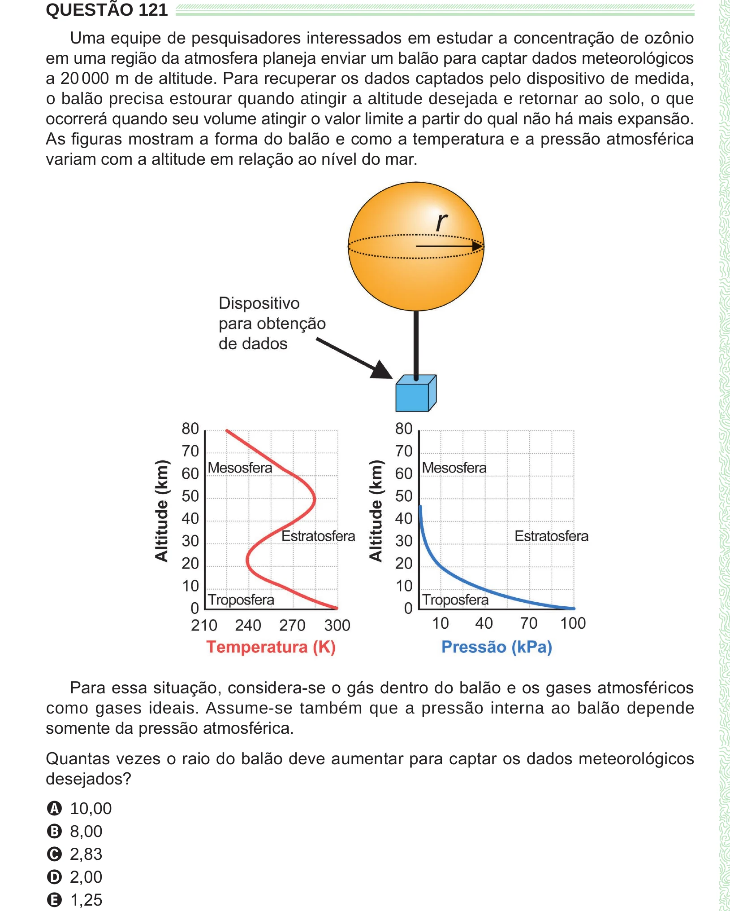

Texto extraído (pode conter ruído)

QUESTÃO 121  
Uma equipe de pesquisadores interessados em estudar a concentração de ozônio  
em uma região da atmosfera planeja enviar um balão para captar dados meteorológicos  
a 20 000 m de altitude. Para recuperar os dados captados pelo dispositivo de medida,  
o balão precisa estourar quando atingir a altitude desejada e retornar ao solo, o que  
ocorrerá quando seu volume atingir o valor limite a partir do qual não há mais expansão.  
As figuras mostram a forma do balão e como a temperatura e a pressão atmosférica  
variam com a altitude em relação ao nível do mar.  
Para essa situação, considera-se o gás dentro do balão e os gases atmosféricos  
como gases ideais. Assume-se também que a pressão interna ao balão depende  
somente da pressão atmosférica.  
Quantas vezes o raio do balão deve aumentar para captar os dados meteorológicos  
desejados?  
A 10,00  
B 8,00  
C 2,83  
D 2,00  
E 1,25

