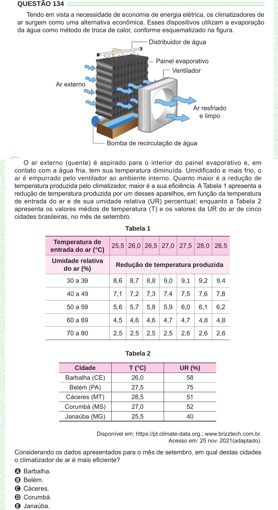

Texto extraído (pode conter ruído)

QUESTÃO 134  
Tendo em vista a necessidade de economia de energia elétrica, os climatizadores de  
ar surgem como uma alternativa econômica. Esses dispositivos utilizam a evaporação  
da água como método de troca de calor, conforme esquematizado na figura.  
contato com a água fria, tem sua temperatura diminuída. Umidificado e mais frio, o  
ar é empurrado pelo ventilador ao ambiente interno. Quanto maior é a redução de  
temperatura produzida pelo climatizador, maior é a sua eficiência. A Tabela 1 apresenta a  
redução de temperatura produzida por um desses aparelhos, em função da temperatura  
de entrada do ar e de sua umidade relativa (UR) percentual; enquanto a Tabela 2  
apresenta os valores médios de temperatura (T) e os valores da UR do ar de cinco  
cidades brasileiras, no mês de setembro.  
Tabela 1  
Temperatura de  
25,5 26,0 26,5 27,0 27,5 28,0 28,5  
entrada do ar (°C)  
Umidade relativa  
Redução de temperatura produzida  
do ar (%)  
30 a 39  
8,6  
8,7  
9,2  
8,8  
9,0  
9,1  
9,4  
7,1  
7,2  
7,3  
7,4  
7,5  
7,6  
7,8  
40 a 49  
50 a 59  
5,6  
5,7  
5,8  
5,9  
6,0  
6,1  
6,2  
60 a 69  
4,5  
4,6  
4,6  
4,7  
4,7  
4,8  
4,8  
70 a 80  
2,5  
2,5  
2,5  
2,5  
2,6  
2,6  
2,6  
Tabela 2  
Cidade  
T (°C)  
UR (%)  
Barbalha (CE)  
26,0  
58  
Belém (PA)  
27,5  
75  
Cáceres (MT)  
28,5  
51  
Corumbá (MS)  
27,0  
52  
Janaúba (MG)  
25,5  
40  
Disponível em: https://pt.climate-data.org.; www.brizztech.com.br.  
Acesso em: 25 nov. 2021(adaptado).  
Considerando os dados apresentados para o mês de setembro, em qual destas cidades  
o climatizador de ar é mais eficiente?  
A Barbalha.  
B Belém.  
C Cáceres.  
D Corumbá.  
E Janaúba.

