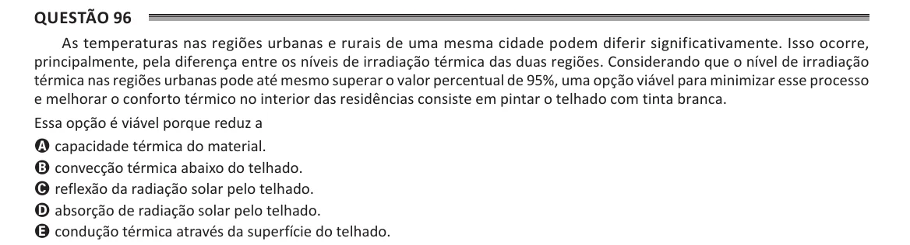

Texto extraído (pode conter ruído)

Questão 96  
As temperaturas nas regiões urbanas e rurais de uma mesma cidade podem diferir significativamente. Isso ocorre,  
principalmente, pela diferença entre os níveis de irradiação térmica das duas regiões. Considerando que o nível de irradiação  
térmica nas regiões urbanas pode até mesmo superar o valor percentual de 95%, uma opção viável para minimizar esse processo  
e melhorar o conforto térmico no interior das residências consiste em pintar o telhado com tinta branca.  
Essa opção é viável porque reduz a  
A capacidade térmica do material.  
B convecção térmica abaixo do telhado.  
C reflexão da radiação solar pelo telhado.  
D absorção de radiação solar pelo telhado.  
E condução térmica através da superfície do telhado.

