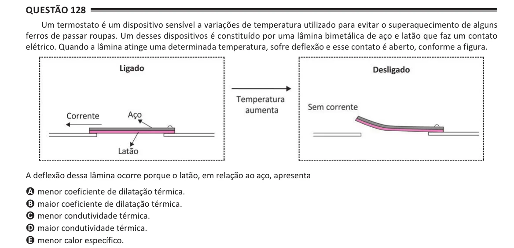

Texto extraído (pode conter ruído)

Questão 128  
Um termostato é um dispositivo sensível a variações de temperatura utilizado para evitar o superaquecimento de alguns  
ferros de passar roupas. Um desses dispositivos é constituído por uma lâmina bimetálica de aço e latão que faz um contato  
elétrico. Quando a lâmina atinge uma determinada temperatura, sofre deflexão e esse contato é aberto, conforme a figura.  
A deflexão dessa lâmina ocorre porque o latão, em relação ao aço, apresenta  
A menor coeficiente de dilatação térmica.  
B maior coeficiente de dilatação térmica.  
C menor condutividade térmica.  
D maior condutividade térmica.  
E menor calor específico.

