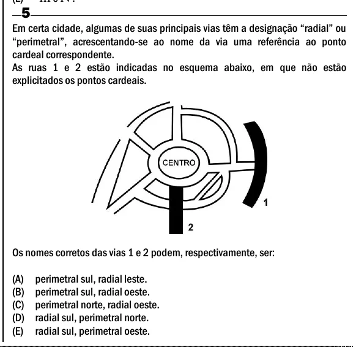

Texto extraído (pode conter ruído)

5  
Em certa cidade, algumas de suas principais vias têm a designação “radial” ou  
“perimetral”, acrescentando-se ao nome da via uma referência ao ponto  
cardeal correspondente.  
As ruas 1 e 2 estão indicadas no esquema abaixo, em que não estão  
explicitados os pontos cardeais.  
Os nomes corretos das vias 1 e 2 podem, respectivamente, ser:  
(A)  
perimetral sul, radial leste.  
(B)  
perimetral sul, radial oeste.  
(C)  
perimetral norte, radial oeste.  
(D)  
radial sul, perimetral norte.  
(E)  
radial sul, perimetral oeste.

