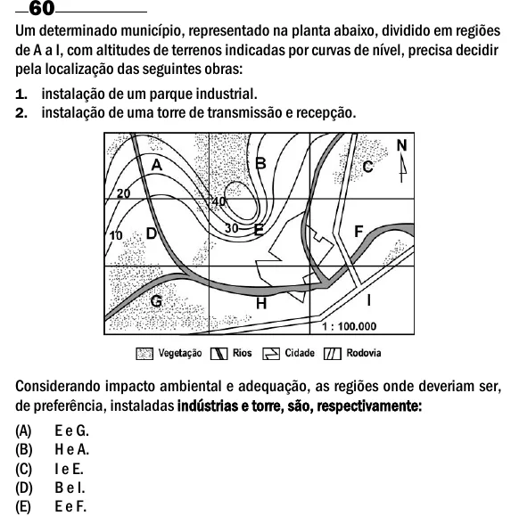

Texto extraído (pode conter ruído)

Um determinado município, representado na planta abaixo, dividido em regiões  
de A a I, com altitudes de terrenos indicadas por curvas de nível, precisa decidir  
pela localização das seguintes obras:  
1. instalação de um parque industrial.  
2. instalação de uma torre de transmissão e recepção.  
Considerando impacto ambiental e adequação, as regiões onde deveriam ser,  
de preferência, instaladas indústrias e torre, são, respectivamente:  
(A)  
E e G.  
(B)  
H e A.  
(C)  
I e E.  
(D)  
B e I.  
(E)  
E e F.

