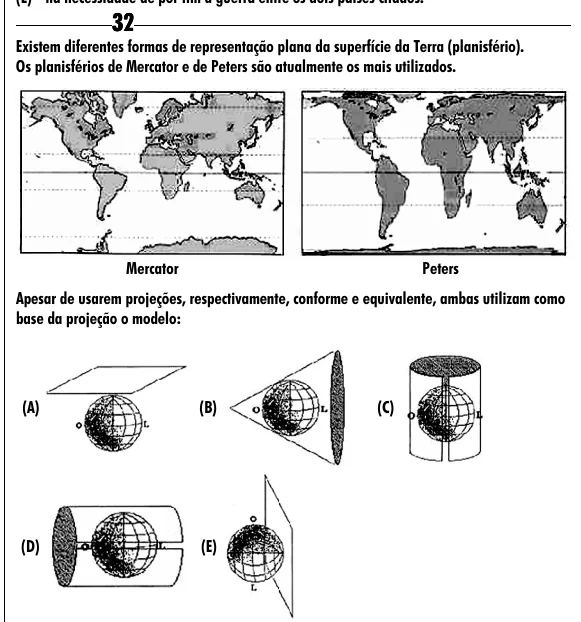

Texto extraído (pode conter ruído)

32  
Existem diferentes formas de representação plana da superfície da Terra (planisfério).  
Os planisférios de Mercator e de Peters são atualmente os mais utilizados.  
Mercator  
Peters  
Apesar de usarem projeções, respectivamente, conforme e equivalente, ambas utilizam como  
base da projeção o modelo:  
(A)  
(B)  
(C)  
(D)  
(E)

