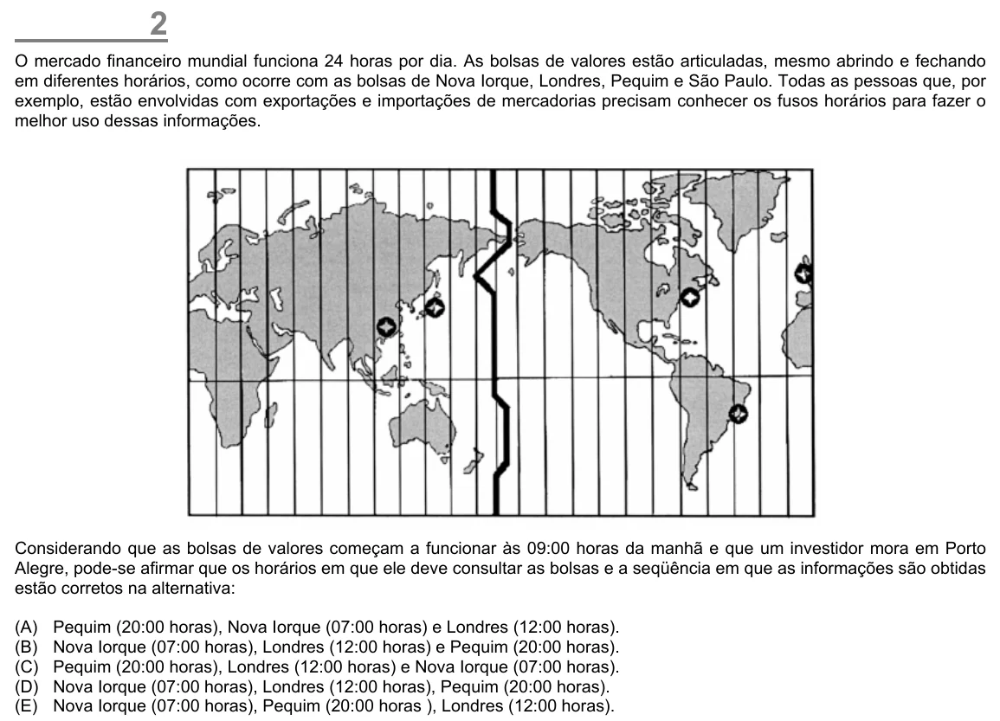

Texto extraído (pode conter ruído)

2  
O mercado financeiro mundial funciona 24 horas por dia. As bolsas de valores estão articuladas, mesmo abrindo e fechando  
em diferentes horários, como ocorre com as bolsas de Nova Iorque, Londres, Pequim e São Paulo. Todas as pessoas que, por  
exemplo, estão envolvidas com exportações e importações de mercadorias precisam conhecer os fusos horários para fazer o  
melhor uso dessas informações.  
Considerando que as bolsas de valores começam a funcionar às 09:00 horas da manhã e que um investidor mora em Porto  
Alegre, pode-se afirmar que os horários em que ele deve consultar as bolsas e a seqüência em que as informações são obtidas  
estão corretos na alternativa:  
(A)  
Pequim (20:00 horas), Nova Iorque (07:00 horas) e Londres (12:00 horas).  
(B)  
Nova Iorque (07:00 horas), Londres (12:00 horas) e Pequim (20:00 horas).  
(C)  
Pequim (20:00 horas), Londres (12:00 horas) e Nova Iorque (07:00 horas).  
(D)  
Nova Iorque (07:00 horas), Londres (12:00 horas), Pequim (20:00 horas).  
(E)  
Nova Iorque (07:00 horas), Pequim (20:00 horas ), Londres (12:00 horas).

