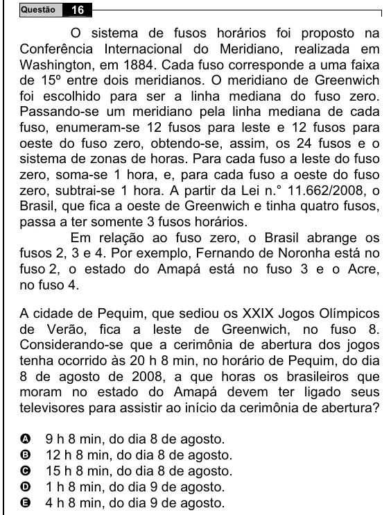

Texto extraído (pode conter ruído)

16  
Questão  
O sistema de fusos horários foi proposto na  
Conferência Internacional do Meridiano, realizada em  
Washington, em 1884. Cada fuso corresponde a uma faixa  
de 15º entre dois meridianos. O meridiano de Greenwich  
foi escolhido para ser a linha mediana do fuso zero.  
Passando-se um meridiano pela linha mediana de cada  
fuso, enumeram-se 12 fusos para leste e 12 fusos para  
oeste do fuso zero, obtendo-se, assim, os 24 fusos e o  
sistema de zonas de horas. Para cada fuso a leste do fuso  
zero, soma-se 1 hora, e, para cada fuso a oeste do fuso  
zero, subtrai-se 1 hora. A partir da Lei n.° 11.662/2008, o  
Brasil, que fica a oeste de Greenwich e tinha quatro fusos,  
passa a ter somente 3 fusos horários.  
Em relação ao fuso zero, o Brasil abrange os  
fusos 2, 3 e 4. Por exemplo, Fernando de Noronha está no  
fuso 2, o estado do Amapá está no fuso 3 e o Acre,  
no fuso 4.  
A cidade de Pequim, que sediou os XXIX Jogos Olímpicos  
de Verão, fica a leste de Greenwich, no fuso 8.  
Considerando-se que a cerimônia de abertura dos jogos  
tenha ocorrido às 20 h 8 min, no horário de Pequim, do dia  
8 de agosto de 2008, a que horas os brasileiros que  
moram no estado do Amapá devem ter ligado seus  
televisores para assistir ao início da cerimônia de abertura?  
9 h 8 min, do dia 8 de agosto.  
A  
B  
12 h 8 min, do dia 8 de agosto.  
15 h 8 min, do dia 8 de agosto.  
C  
D  
1 h 8 min, do dia 9 de agosto.  
E  
4 h 8 min, do dia 9 de agosto.

