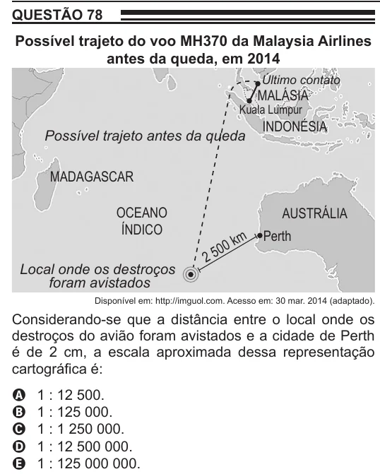

Texto extraído (pode conter ruído)

QUESTÃO 78  
Possível trajeto do voo MH370 da Malaysia Airlines  
antes da queda, em 2014  
Último contato  
MALÁSIA  
Kuala Lumpur  
INDONÉSIA  
Possível trajeto antes da queda  
MADAGASCAR  
OCEANO  
AUSTRÁLIA  
ÍNDICO  
km  
Perth  
00  
2 5  
Local onde os destroços  
foram avistados  
Disponível em: http://imguol.com. Acesso em: 30 mar. 2014 (adaptado).  
Considerando-se que a distância entre o local onde os  
destroços do avião foram avistados e a cidade de Perth  
é de 2 cm, a escala aproximada dessa representação  
cartográfica é:  
A  
1 : 12 500.  
B  
1 : 125 000.  
1 : 1 250 000.  
C  
1 : 12 500 000.  
D  
1 : 125 000 000.  
E

