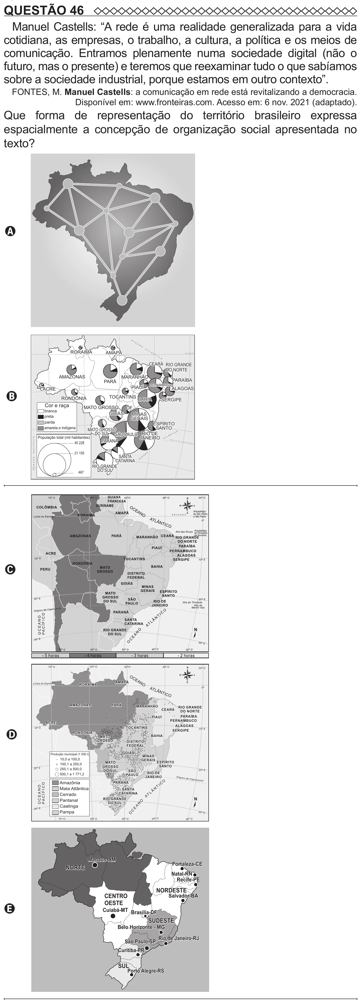

Texto extraído (pode conter ruído)

QUESTÃO 46  
Manuel Castells: “A rede é uma realidade generalizada para a vida  
cotidiana, as empresas, o trabalho, a cultura, a política e os meios de  
comunicação. Entramos plenamente numa sociedade digital (não o  
futuro, mas o presente) e teremos que reexaminar tudo o que sabíamos  
sobre a sociedade industrial, porque estamos em outro contexto”.  
FONTES, M. Manuel Castells: a comunicação em rede está revitalizando a democracia.  
Disponível em: www.fronteiras.com. Acesso em: 6 nov. 2021 (adaptado).  
Que forma de representação do território brasileiro expressa  
espacialmente a concepção de organização social apresentada no  
texto?  
A  
O  
C  
E  
A  
N  
O  
A  
RORAIMA  
T  
AMAPÁ  
L  
  
N  
E Q U A D O R  
T  
I  
C  
O  
CEARÁ RIO GRANDE  
DO NORTE  
CEARÁ  
AMAZONAS  
MARANHÃO  
PARAÍBA  
PARÁ  
PERNAMBUCO  
PIAUÍ  
ALAGOAS  
ACRE  
B  
TOCANTINS  
RONDÔNIA  
BAHIA  
SERGIPE  
Cor e raça  
MATO GROSSO  
DF  
branca  
GOIÁS  
MINAS  
preta  
GERAIS  
parda  
ESPÍRITO  
amarela e indígena  
SANTO  
MATO GROSSO  
DO SUL SÃO PAULO RIO DE  
O  
I C  
N  
T  
População total (mil habitantes)  
JANEIRO  
  
P A C Í F I C O  
T  
L  
PARANÁ  
A  
T R Ó  
P I C  
45 228  
O  
D E  
C A P  
R I C  
Ó R N  
I O  
21 155  
O  
SANTA  
A  
N  
E  
O C E A N O  
C  
CATARINA  
O  
RIO GRANDE  
DO SUL  
467  
C  
70º O  
60º O  
50 º O  
40 º O  
N  
30ª O  
OC  
O  
L  
EA  
NO  
AMAPÁ  
Linha do Equador  
RORAIMA  
S  
ATL  
0º  
  
N TI  
CO  
AMAZONAS  
PARÁ  
MARANHÃO  
RIO GRANDE  
CEARÁ  
DO NORTE  
PARAÍBA  
PIAUÍ  
PERNAMBUCO  
ACRE  
ALAGOAS  
TOCANTINS  
10 º S  
10º S  
D  
SERGIPE  
RONDÔNIA  
BAHIA  
MATO  
GROSSO  
DISTRITO  
FEDERAL  
GOIÁS  
Produção municipal (1 000 t)  
MINAS  
10,0 a 100,0  
GERAIS  
ESPÍRITO  
MATO  
100,1 a 250,0  
GROSSO  
SANTO  
20 º S  
250,1 a 500,0  
DO SUL  
SÃO  
20º S  
RIO DE  
500,1 a 1 771,2  
PAULO  
JANEIRO  
Tr óp ic o  
de C ap ri  
có rn io  
Amazônia  
PARANÁ  
O  
PA C Í F I C O  
IC  
OCEANO  
T  
Mata Atlântica  
SANTA  
N  
LÂ  
Cerrado  
CATARINA  
T  
A  
N  
Pantanal  
RIO GRANDE  
DO SUL  
O  
Caatinga  
N  
A  
30 º S  
E  
Pampa  
C  
30 º S  
O  
70º O  
60º O  
50º O  
40º O  
30º O  
Manaus-AM  
Fortaleza-CE  
NORTE  
Natal-RN  
Recife-PE  
NORDESTE  
CENTRO  
Salvador-BA  
OESTE  
E  
Cuiabá-MT Brasília-DF  
SUDESTE  
Belo Horizonte - MG  
Rio de Janeiro-RJ  
São Paulo-SP  
Curitiba-PR  
SUL  
Porto Alegre-RS

