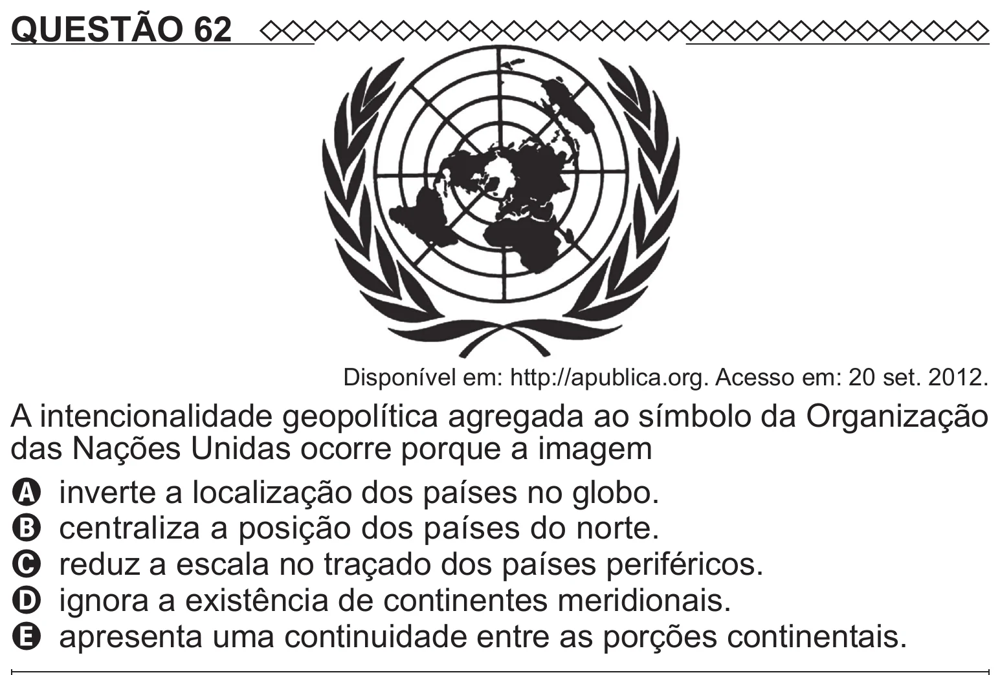

Texto extraído (pode conter ruído)

QUESTÃO 62  
Disponível em: http://apublica.org. Acesso em: 20 set. 2012.  
A intencionalidade geopolítica agregada ao símbolo da Organização  
das Nações Unidas ocorre porque a imagem  
A inverte a localização dos países no globo.  
B centraliza a posição dos países do norte.  
C reduz a escala no traçado dos países periféricos.  
D ignora a existência de continentes meridionais.  
E apresenta uma continuidade entre as porções continentais.

