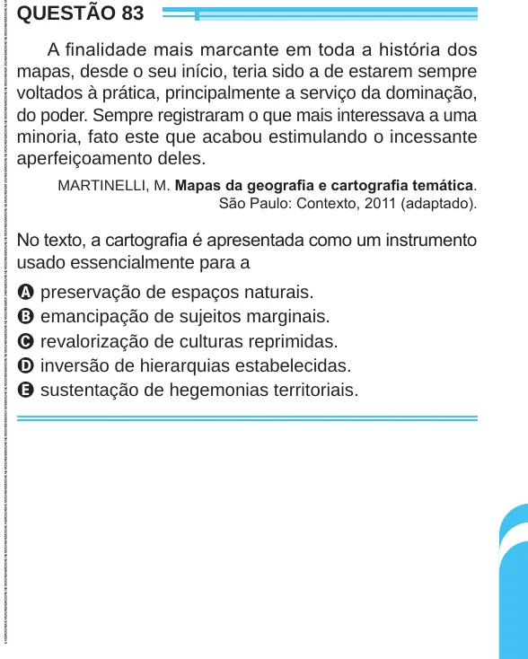

Texto extraído (pode conter ruído)

QUESTÃO 83  
A finalidade mais marcante em toda a história dos  
mapas, desde o seu início, teria sido a de estarem sempre  
voltados à prática, principalmente a serviço da dominação,  
do poder. Sempre registraram o que mais interessava a uma  
minoria, fato este que acabou estimulando o incessante  
aperfeiçoamento deles.  
MARTINELLI, M. Mapas da geografia e cartografia temática.  
São Paulo: Contexto, 2011 (adaptado).  
No texto, a cartografia é apresentada como um instrumento  
usado essencialmente para a  
A preservação de espaços naturais.  
B emancipação de sujeitos marginais.  
C revalorização de culturas reprimidas.  
D inversão de hierarquias estabelecidas.  
E sustentação de hegemonias territoriais.

