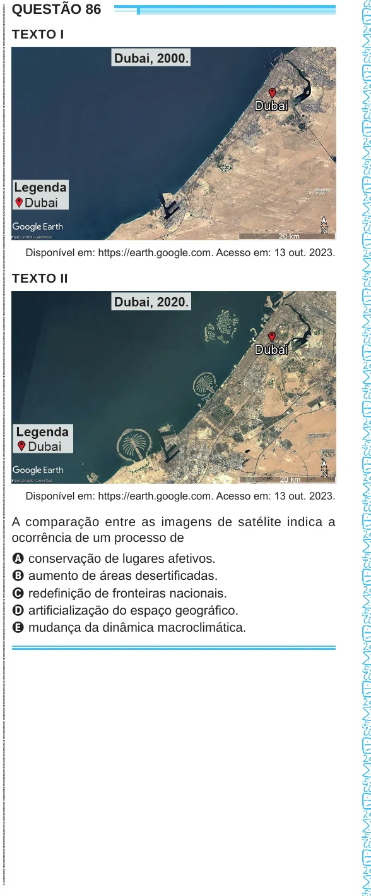

Texto extraído (pode conter ruído)

ENEM2024ENEM2024ENEM2024ENEM2024ENEM2024ENEM2024ENEM2024ENEM2024ENEM2024ENEM2024ENEM2024ENEM2024ENEM2024ENEM2024ENEM2024ENEM2024ENEM2024ENEM2024ENEM2024ENEM2024ENEM2024ENEM2024ENEM2024ENEM2024ENEM2024ENEM2024ENEM2024ENEM2024ENEM2024ENEM2024ENEM2024ENEM2024ENEM2024ENEM2024ENEM2024ENEM2024ENEM2024ENEM2024ENEM2024ENEM2024ENEM2024ENEM2024ENEM2024ENEM2024ENEM2024ENEM2024ENEM2024ENEM2024ENEM2024ENEM2024ENEM2024ENEM2024ENEM2024ENEM2024ENEM2024ENEM2024ENEM2024ENEM2024ENEM2024ENEM2024ENEM2024ENEM2024ENEM2024ENEM2024ENEM2024ENEM2024ENEM2024ENEM2024ENEM2024ENEM2024ENEM2024ENEM2024ENEM2024ENEM2024ENEM2024  
QUESTÃO 86  
TEXTO I  
Disponível em: https://earth.google.com. Acesso em: 13 out. 2023.  
TEXTO II  
Disponível em: https://earth.google.com. Acesso em: 13 out. 2023.  
A comparação entre as imagens de satélite indica a  
ocorrência de um processo de  
A conservação de lugares afetivos.  
B aumento de áreas desertificadas.  
C redefinição de fronteiras nacionais.  
D artificialização do espaço geográfico.  
E mudança da dinâmica macroclimática.

