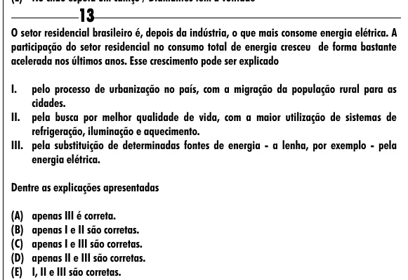

Texto extraído (pode conter ruído)

13  
O setor residencial brasileiro é, depois da indústria, o que mais consome energia elétrica. A  
participação do setor residencial no consumo total de energia cresceu de forma bastante  
acelerada nos últimos anos. Esse crescimento pode ser explicado  
I.  
pelo processo de urbanização no país, com a migração da população rural para as  
cidades.  
II. pela busca por melhor qualidade de vida, com a maior utilização de sistemas de  
refrigeração, iluminação e aquecimento.  
III. pela substituição de determinadas fontes de energia - a lenha, por exemplo - pela  
energia elétrica.  
Dentre as explicações apresentadas  
(A) apenas III é correta.  
(B) apenas I e II são corretas.  
(C) apenas I e III são corretas.  
(D) apenas II e III são corretas.  
(E) I, II e III são corretas.

